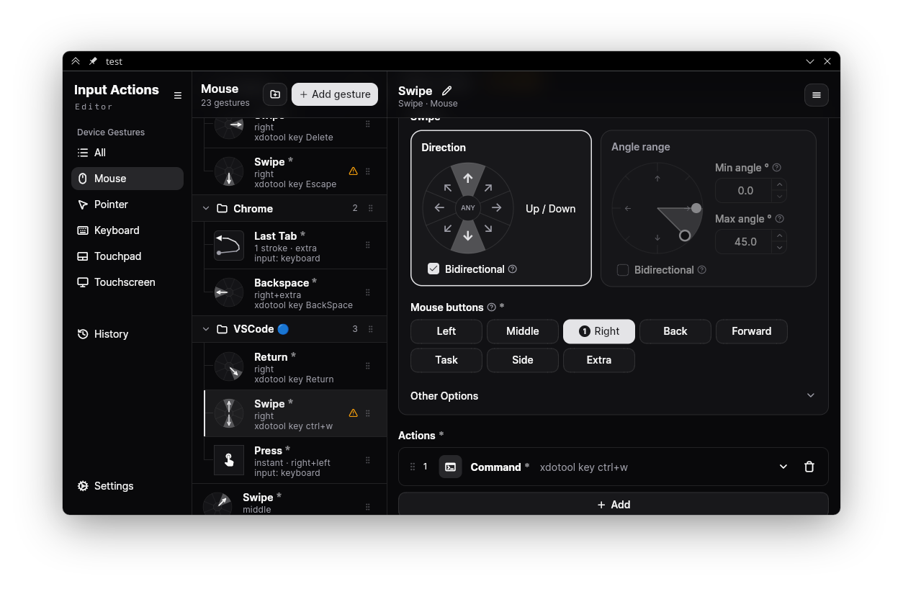

<h1 align="center">Input Actions Editor</h1>

<p align="center">A desktop GUI for configuring <a href="https://github.com/taj-ny/InputActions">Input Actions</a>.</p>




## Features

- Stroke recording and path visualization, recorded from the daemon over D-Bus, with renamable strokes.
- Triggers for mouse, keyboard, pointer, touchpad and touchscreen, including finger ranges and lock pointer.
- Multiple actions per gesture, run in order, each with its own event (`on`), interval, threshold and conditions.
- Supported action types:
    - Run a command
    - Send input (keyboard and mouse), with key sequences recorded straight from the keyboard
    - Trigger a Plasma shortcut, chosen from a picker
    - Activate a window
    - Replace text
    - Sleep
    - First match: a group that runs the first nested action whose conditions match
    - Context menu: a menu of items, submenus, sections and separators, each item with its own icon, mnemonic and actions
    - Functions
- Nested conditions on both triggers and actions.
- Trigger groups, nested to any depth: gestures inherit trigger fields and conditions from the groups around them.
- Copy, paste and duplicate gestures and actions, with undo and redo for every edit.
- Conflict detection while editing.
- Settings for the daemon: autoreload, mouse stroke overlay, notifications, emergency combination, device rules and per-device speed.
- Recognition history of the gestures the daemon saw.
- YAML that round-trips: comments and anchors are kept, and keys the editor doesn't know are preserved and shown as RAW entries.
- Rolling backups of the config on every save, and a shortcut to open it in a text editor.

## Installation

### Fedora

Packages are published on [Copr](https://copr.fedorainfracloud.org/coprs/luwxs/input-actions-editor/):

```sh
sudo dnf copr enable luwxs/input-actions-editor
sudo dnf install input-actions-editor
```

Builds are available for Fedora 43, 44 and 45.

### Other distributions

Each [GitHub release](https://github.com/luwx/InputActionsEditor/releases) has a `.deb`, an `.rpm`, an AppImage and a tarball of the bundle. You can also build from source as described below.

## Building

### Flutter

Use Flutter **3.44.x**, the version CI and the release builds use. Other versions may work but are not tested. Check yours with:

```sh
flutter --version
```

Linux desktop support must be enabled (it is by default on current Flutter; `flutter doctor` reports it).

### System dependencies

The build compiles native code: Flutter's GTK embedder, and the Wayland code from some KDE/Linux integration packages used for window blur and global menu. Those packages compile their C code during `flutter build` through Dart build hooks, which run `pkg-config` and `wayland-scanner`.

Fedora:

```sh
sudo dnf install clang cmake ninja-build pkgconf-pkg-config \
  gtk3-devel xz-devel wayland-devel
```

Debian/Ubuntu:

```sh
sudo apt install clang cmake ninja-build pkg-config build-essential \
  libgtk-3-dev liblzma-dev libwayland-dev
```

### KDE helpers (optional)

The `kde_icon_lookup` and `kde_key_lookup` helpers need Qt 6 and KDE Frameworks 6 to compile. Without these libraries the build skips them and the app still runs, just without native KDE icon and key resolution.

Fedora:

```sh
sudo dnf install qt6-qtbase-devel extra-cmake-modules \
  kf6-kiconthemes-devel kf6-kservice-devel
```

Debian/Ubuntu:

```sh
sudo apt install qt6-base-dev extra-cmake-modules \
  libkf6iconthemes-dev libkf6service-dev
```

### Build and run

Fetch the dependencies:

```sh
flutter pub get
```

The generated code (`*.g.dart`, `*.freezed.dart`) is committed. After changing a model or the edit schema, regenerate it:

```sh
dart run build_runner build --delete-conflicting-outputs
```

Release build, with the output in `build/linux/x64/release/bundle/`:

```sh
flutter build linux --release
```

`build/linux/x64/release/bundle/input_actions_editor` runs from there. The bundle keeps its libraries in `lib/`, so move the whole folder rather than the binary alone.

### Packages

`scripts/` builds the release packages from that bundle:

```sh
scripts/build.sh          # flutter build linux --release
scripts/package-all.sh    # stage, then .deb, .rpm, AppImage and tarball in packaging/
```

`package-all.sh` needs [fpm](https://fpm.readthedocs.io/) for the `.deb` and `.rpm`, and [appimagetool](https://github.com/AppImage/appimagetool) for the AppImage. Each `scripts/package-*.sh` also runs on its own after `scripts/stage.sh`.

### Runtime

Window blur and the global menu need a KDE Plasma Wayland session; elsewhere the app runs without them. Gestures are applied by the [Input Actions](https://github.com/taj-ny/InputActions) daemon, which the editor talks to over D-Bus.
