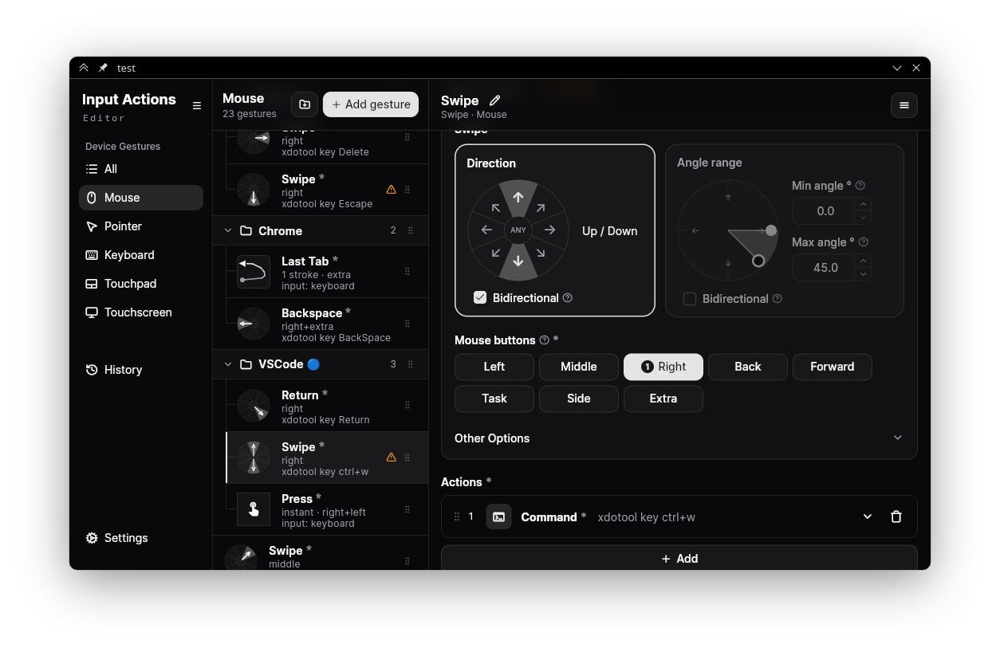

<h1 align="center">Input Actions Editor</h1>

<p align="center">A desktop GUI for configuring <a href="https://github.com/taj-ny/InputActions">Input Actions</a>.</p>




## Features

- Stroke recording and path visualization, recorded from the daemon over D-Bus.
- Plasma shortcut picker.
- Multiple actions per gesture, run in order.
- Grouping and reordering for long gesture lists.
- Nested conditions on both triggers and actions.
- Conflict detection while editing.
- Supported action types configuration: 
    - Run a command 
    - Send input (Keyboard/Mouse) 
    - Trigger a Plasma shortcut 
    - Sleep 
    - Activate window
    - Replace text
    - One (first match)
    - Functions

## Installation

### Fedora

Packages are published on [Copr](https://copr.fedorainfracloud.org/coprs/luwxs/input-actions-editor/):

```sh
sudo dnf copr enable luwxs/input-actions-editor
sudo dnf install input-actions-editor
```

On other distributions, build from source as described below or download the binaries from Github releases.

## Building

### Flutter

Use Flutter **3.44.x**, the version CI and the release builds use. Other versions may work but are not tested. Check yours with:

```sh
flutter --version
```

Linux desktop support must be enabled (it is by default on current Flutter; `flutter doctor` reports it).

### System dependencies

The build compiles native code: Flutter's GTK embedder, and the Wayland code from some KDE/Linux integration packages used for window blur and global menu. Those packages compile their C code during `flutter build` through Dart build hooks, which run `pkg-config` and `wayland-scanner`.

Fedora:

```sh
sudo dnf install clang cmake ninja-build pkgconf-pkg-config \
  gtk3-devel xz-devel wayland-devel
```

Debian/Ubuntu:

```sh
sudo apt install clang cmake ninja-build pkg-config build-essential \
  libgtk-3-dev liblzma-dev libwayland-dev
```

### KDE helpers (optional)

The `kde_icon_lookup` and `kde_key_lookup` helpers need Qt 6 and KDE Frameworks 6 to compile. Without these libraries the build skips them and the app still runs, just without native KDE icon and key resolution.

Fedora:

```sh
sudo dnf install qt6-qtbase-devel extra-cmake-modules \
  kf6-kiconthemes-devel kf6-kservice-devel
```

Debian/Ubuntu:

```sh
sudo apt install qt6-base-dev extra-cmake-modules \
  libkf6iconthemes-dev libkf6service-dev
```

### Build and run

Fetch the dependencies and generate code.

```sh
flutter pub get
dart run build_runner build --delete-conflicting-outputs
```


Release build, with the output in `build/linux/x64/release/bundle/`:

```sh
flutter build linux --release
```

`build/linux/x64/release/bundle/input_actions_editor` runs from there. The bundle keeps its libraries in `lib/`, so move the whole folder rather than the binary alone.

### Packages

`scripts/` builds the release packages from that bundle:

```sh
scripts/build.sh          # flutter build linux --release
scripts/package-all.sh    # stage, then .deb, .rpm, AppImage and tarball in packaging/
```

`package-all.sh` needs [fpm](https://fpm.readthedocs.io/) for the `.deb` and `.rpm`, and [appimagetool](https://github.com/AppImage/appimagetool) for the AppImage. Each `scripts/package-*.sh` also runs on its own after `scripts/stage.sh`.

### Runtime

Window blur and the global menu need a KDE Plasma Wayland session; elsewhere the app runs without them. Gestures are applied by the [Input Actions](https://github.com/taj-ny/InputActions) daemon, which the editor talks to over D-Bus.
